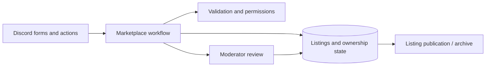

# DayZ Transport Marketplace — Engineering Case Study

**Moderated vehicle listings, ownership records, reservations and dispute workflows for a roleplay community.**

> **Private-source portfolio case study.** This repository is not a runnable application. The interface skeleton in `src/public_interface.py` deliberately raises `NotImplementedError`; production code and customer data are not included.

## Why a marketplace needs backend workflows

A Discord marketplace is more than posting sale messages. Sellers, buyers, moderators and owners need consistent rules for creating listings, checking ownership, reviewing submissions, reserving items and recording disputes.

The private project documents an approach to keeping these workflows organized around state and staff review rather than unstructured chat messages.

## User journeys

| Journey | Typical stages | Backend concern |
|---|---|---|
| Vehicle listing | Form → validation → staff review → publication | Input validation, authorization, review state |
| Reservation | Listing available → reserved → completed or reopened | Consistency between competing requests |
| Ownership registry | Submit vehicle details → verify registry → update | Data integrity, duplicate entries |
| Complaint | Report → collect context → staff review → resolution | Permission boundaries, audit trail |
| Marketplace controls | Rules / blacklist / archive updates | Administrative access, persistent configuration |

*These are workflow illustrations; the exact live transitions and policies are private and may differ by deployment.*

## Architecture sketch

**Technology context:** Python, discord.py 2.x, persistent Discord views and SQLite/WAL. The production implementation and schema are withheld.

## Engineering trade-offs

- **Concurrent reservations:** two users may request the same listing. A robust implementation needs an atomic state transition.
- **Identity and ownership:** a Discord identity or submitted vehicle description alone is not independent proof of ownership.
- **Moderation permissions:** staff actions must be checked server-side, not just by hiding buttons.
- **Auditability:** state changes should retain the actor, timestamp and reason when applicable.
- **Recovery:** persistent views and stored workflow state need synchronization after restarts.

These are **design considerations**, not a claim that the public skeleton implements them.

## What is public?

- [Architecture overview](docs/ARCHITECTURE.md)
- [Interface signatures](src/public_interface.py) — **not runnable**
- [Illustrative configuration](examples/config.example.jsonc) — no production IDs or credentials
- [Publication notice](NOTICE.md)

For **runnable Python** and CI examples, see [Ticket Workflow Backend](https://github.com/Scumbagsss/advanced-discord-ticket-bot) and [Server Monitoring Pipeline](https://github.com/Scumbagsss/dayz-server-monitor-bot).

**Author:** [Scumbagsss](https://github.com/Scumbagsss) · Python Backend · Automation

**Contact:** Discord — `scumbagsss` · Telegram — [@dilarion](https://t.me/dilarion).
