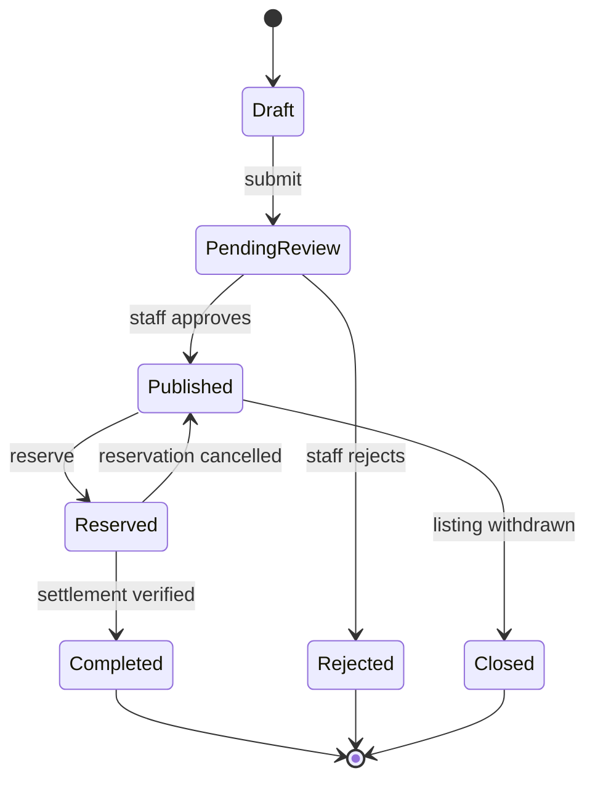

# Marketplace workflow — engineering design notes

> **Portfolio design exercise.** These are architectural concerns and recommended invariants for a moderated vehicle marketplace, **not a verified specification of the private deployed service**. The public interface is intentionally unimplemented.

## Conceptual entities

| Entity | Example fields (fictional) | Responsibility |
|---|---|---|
| Applicant | Synthetic member ID | Ownership of a submitted request |
| Vehicle | Fictional vehicle reference | Subject of a listing |
| Listing | ID, owner, vehicle, proposed price, status | Marketplace representation |
| Review | Reviewer ID, outcome, reason, timestamp | Traceability of staff decisions |
| Reservation | Listing ID, interested member, expiry | Temporary claim to a listing |
| Audit event | Actor, action, timestamp, related ID | Historical record |

No commercial table schema or live class names are reproduced.

## Conceptual lifecycle

This is a **suggested demonstration state machine**, not a guaranteed set of production states.

## Invariants worth testing

1. **One active reservation per listing:** two simultaneous attempts must not both succeed.
2. **Only authorized staff can publish/reject:** UI visibility alone does not enforce permissions.
3. **A closed listing is immutable to buyers:** no post-closure reservation or edits.
4. **Every status change is audited:** the event records an authorized actor and source state.
5. **Ownership is independently verified:** text supplied by a user is not proof of ownership.
6. **Retries are safe:** duplicate Discord interactions or worker retries do not publish duplicates.

## Failure-mode matrix

| Event | Failure | Safer approach |
|---|---|---|
| Two buyers press Reserve | Double reservation | Transactional compare-and-swap state transition |
| Review response is delivered twice | Duplicate listing publication | Stable idempotency key for review action |
| Bot restarts during review | Lost status or stale buttons | Persist state and reconstruct views safely |
| Staff role changes | Former staff can still use interaction | Permission check at time of mutation |
| User-provided media URL is malformed | Broken embeds or unsafe link | URL validation and controlled rendering |
| Audit channel unavailable | Action succeeds without trace | Persistent outbox or explicit error/retry policy |

These are **recommended mitigations**, not claims of existing implementation.

## Portfolio evaluation

The private project demonstrates a workflow domain with real business constraints; this public repository provides architecture, review questions and an intentional boundary against redistributing proprietary source. For independently runnable Python implementations, inspect [Ticket Workflow Backend](https://github.com/Scumbagsss/advanced-discord-ticket-bot) and [Priority Access REST API](https://github.com/Scumbagsss/priority-access-bot).

## Publication policy

No customer names, player IDs, ownership registers, prices tied to real accounts, credentials, logs or commercial data structures are shared.
